# CodingAgentsWorkflow

Wersja 1.5.1. Framework do prowadzenia projektów programistycznych zespołem agentów AI (Claude Code i wykonawcy innych dostawców): od discovery, przez spec, plan i kod, po recenzje, bezpieczeństwo i wydanie. Działa dla jednej osoby i dla zespołów wielu deweloperów, w nowym i istniejącym projekcie.

Zawiera:
- **metodę** (`docs/`): reguły z identyfikatorami (`KOD-3`, `BZP-5`…), procedury i runbooki, które agent wykonuje krok po kroku; instalowana w projekcie jako `docs/workflow/metoda/`;
- **kit** (`kit/`): agentów (`designer`, `implementer`, `reviewer`, `qa`, `mechanic`, `security`), skill orkiestracji, hooki Claude Code (reguły i stan po starcie, wznowieniu i kompakcji; reguły dla subagentów; strażnik blokujący polecenia łamiące reguły; strażnik pętli pilnujący wybudzeń), skrypty (pętla orkiestratora, stany zadań, decyzje, budżet maszyny, kolejka ciężkich poleceń, skanery sekretów, zajmowanie pasów, router wykonawców), szablony, profile stosów (TypeScript, Python), CI i CODEOWNERS;
- **kreator** (`scripts/setup.mjs`): zakłada nowy projekt, wdraża proces w istniejącym i aktualizuje framework.

## Start

```bash
# Bez klonowania frameworka (bin coding-agents-workflow → scripts/setup.mjs)
npx github:NovaSeth/CodingAgentsWorkflow

# Z klonu
git clone https://github.com/NovaSeth/CodingAgentsWorkflow.git ~/CodingAgentsWorkflow
node ~/CodingAgentsWorkflow/scripts/setup.mjs

# Bez pytań
npx github:NovaSeth/CodingAgentsWorkflow --yes --mode new --path ~/Code/sklep --name "Sklep" \
  --team zespol --stack typescript --backend --areas koszyk,platnosci --owners @org/platforma --author MG

# Podgląd bez zmian
npx github:NovaSeth/CodingAgentsWorkflow --dry-run --mode existing --path ~/Code/istniejacy

# Wspólny standard firmy: odpowiedzi z pliku (późniejsze flagi je nadpisują)
npx github:NovaSeth/CodingAgentsWorkflow --yes --answers standard-firmy.json --path ~/Code/x --name x
```

Każdy deweloper po sklonowaniu projektu uruchamia raz na swojej maszynie:
```bash
.workflow/bin/dev-setup.sh --author MG   # hooki gita, inicjały (git config workflow.author), progi budżetu tej maszyny
```

Wymagania: `git`, `node` ≥ 18 (kreator, router, tick), `bash`. Profil TypeScript: Node ≥ 24. Profil Python: Python ≥ 3.11.

### Pierwsze zadanie (poziom minimum)

Cykl od pustego katalogu do `KONIEC` pętli; w sesji Claude Code kroki wykonuje orkiestrator, a `tick.mjs` po każdym kroku mówi, co dalej.
```bash
npx github:NovaSeth/CodingAgentsWorkflow --yes --mode new --path ~/Code/demo --name demo --level minimum --scale maly
cd ~/Code/demo && node .workflow/bin/tick.mjs             # AKCJA: uzupełnij CLAUDE.md, napisz spec i plan
# plan w docs/plans/<data>-<temat>.md z nagłówkami „### Zadanie T1: …”
bash .workflow/bin/brief.sh T1                            # brief → .workflow/tasks/T1/brief.md
bash .workflow/bin/task.sh T1 dispatched --exec implementer --base "$(git rev-parse --short HEAD)"
# implementer pisze .workflow/tasks/T1/report.md, recenzent review-r1.md (werdykt **Approved** / **Needs fixes**)
bash .workflow/bin/task.sh T1 complete "PR #1, <sha na main>"
bash .workflow/bin/task.sh gate <obszar>                  # bramka obszaru → tick zwraca KONIEC (kod 4)
```

## Co określa kreator

Flaga `--<klucz> wartość` albo `--<klucz>=wartość`; tak/nie: `--ui`, `--no-ui`, `--ui=nie`. Pełna lista: `setup.mjs --help`.

| Pytanie (klucz) | Domyślnie | Wpływ |
|---|---|---|
| nowy / istniejący (`mode`) | `new` | nowy: `git init`, szkielet stosu, commit startowy; istniejący: dokłada pliki, nie nadpisuje (`CLAUDE.md` → `CLAUDE.workflow.md`) |
| zespół (`team`): `solo` / `zespol` (2–5) / `duzy` (6+) | `solo` | zespół: serie decyzji per osoba, `claim.sh`, CODEOWNERS, `merge=union`, `docs/workflow/zespol.md` |
| skala (`scale`): `maly` / `sredni` / `duzy` | `sredni` | sugerowany poziom procesu |
| stos (`stack`): `typescript` / `python` / `inny` | `typescript` | polecenia bramki w `CLAUDE.md` i CI, szkielet z testem architektury, profil `.workflow/stacks/<stos>/` |
| UI (`ui`) | tak | szablony design systemu |
| backend (`backend`): „Czy jest backend z zapisami / danymi wielu użytkowników?” | tak (poza stosem `inny`) | Global Constraints o idempotencji i dzierżawcach w `CLAUDE.md` |
| discovery (`discovery`) | tak dla nowego przy skali ≠ `maly` | szablony researchu i KANON |
| drugi dostawca (`second-provider`) | nie | `run-other.sh`, router z dwoma dostawcami |
| poziom (`level`): minimum / standard / full | z odpowiedzi | zakres kitu: **full** przy `duzy` albo drugim dostawcy; **standard** przy `zespol` albo skali ≠ `maly`; inaczej **minimum** |
| CI (`ci`): `github` / `brak` | `brak` dla `solo` | `.github/workflows/bramki.yml` (joby `bramki / proces`, `bramki / jakosc`, `bramki / wynik`; `npm ci` przy lockfile; `check-ledger.mjs`; akcje przypięte do SHA) + szablon PR |
| obszary (`areas`), właściciele (`owners`), PO (`po`), `security-owner` | — | pasy w podręczniku i `zespol.md`, CODEOWNERS |
| inicjały (`author`) | `git config workflow.author`, inaczej z `user.name` | tylko `git config workflow.author`; NIE trafiają do `config.json` |
| tylko nowy: `install-deps`, `commit` | nie, tak | instalacja zależności, commit startowy (bez push) |

Odpowiedzi zostają w `.workflow/config.json`, sumy SHA-256 zainstalowanych plików w `.workflow/kit-files.json`. Wyższy poziom: kreator z `--answers .workflow/config.json --mode existing --level <poziom>` (istniejące pliki są pomijane). W zespole ochrona `main` wymaga tylko checku `bramki / wynik` (job zbiorczy) + Code Owners.

## Poziomy

| Poziom | Dla kogo | Zawiera |
|---|---|---|
| **minimum** | 1 osoba, mały projekt | metoda, `CLAUDE.md` (Global Constraints, Review Focus, definicja ukończenia, mapa wiedzy), ledger + `ruling.sh` + `task.sh` + `check-ledger.mjs`, `tick.mjs`, `rules.mjs`, hooki, skan przed startem, lekcje, podręcznik orkiestratora, implementer + reviewer + security, przewodnik bezpieczeństwa, szablony, `check-secrets.sh` + `pre-push`, `brief.sh`, `dev-setup.sh` |
| **standard** | kilku agentów równolegle, zespół 2–5 | + designer, qa, mechanic, skill orkiestracji, `heavy.sh`, `budget.sh`, `check-key-leak.sh`, `sync-agent-rules.sh`, brief wspólny, szablony bramek i audytów |
| **full** | wielu wykonawców, kilku dostawców, zespoły 6+ | + router wykonawców z kartą wyników, `run-other.sh` |

Które reguły są obowiązkowe na którym poziomie: [13 §Poziom → reguły obowiązkowe](docs/13-wdrozenie-w-projekcie.md).

## Metoda (`docs/`)

| Nr | Dokument | Prefiks reguł |
|---|---|---|
| 00 | [Indeks: router wiedzy (sytuacja → sekcja)](docs/00-indeks.md) | — |
| 01 | [Zasady naczelne](docs/01-zasady-naczelne.md) | ZAS |
| 02 | [Proces od pomysłu do wydania](docs/02-proces-end-to-end.md) | PRC |
| 03 | [Discovery: research, wywiady, raport decyzyjny, KANON](docs/03-discovery-research-makiety.md) | DSC |
| 04 | [Spec i plan](docs/04-spec-i-plan.md) | SPC |
| 05 | [Jak kodować](docs/05-jak-kodowac.md) | KOD |
| 06 | [Orkiestracja, role, router](docs/06-orkiestracja-i-role.md) | ORK |
| 07 | [Zasoby maszyny i współbieżność](docs/07-zasoby-i-wspolbieznosc.md) | RES |
| 08 | [Recenzje i bramki](docs/08-recenzje-i-bramki.md) | REV |
| 09 | [Bezpieczeństwo](docs/09-bezpieczenstwo.md) | BZP (ustalenia `SEC-<n>`) |
| 10 | [Design system](docs/10-design-system.md) | DSN |
| 11 | [Pamięć projektu: ledger, lekcje, wznowienie](docs/11-pamiec-projektu.md) | MEM |
| 12 | [Pułapki narzędziowe](docs/12-pulapki-narzedziowe.md) | PUL |
| 13 | [Wdrożenie, poziom → reguły, aktualizacja](docs/13-wdrozenie-w-projekcie.md) | WDR |
| 14 | [Zespół wielu deweloperów](docs/14-zespol-wielu-deweloperow.md) | ZES |
| 15 | [Słownik, skale wag, skrypty, szablony](docs/15-slownik-skrypty-szablony.md) | — |
| 16 | [Runbooki: konflikt merge, spór, hotfix, wycofanie, awaria, migracja…](docs/16-runbooki.md) | RUN |

## Proces w skrócie

```mermaid
flowchart LR
  D["Discovery<br/>KANON"] --> S["Spec"] --> P["Plan<br/>Global Constraints"]
  P --> B["Brief"] --> R["Router +<br/>budżet maszyny"] --> I["Implementer<br/>worktree, TDD"]
  I --> G["Bramka zadania"] --> V["Recenzja<br/>(inny wykonawca)"]
  V -->|poprawki| F["Runda poprawek"] --> RR["Ponowna recenzja<br/>zawężona"] --> PR
  V -->|ok| PR["PR + CI"] --> L["Ledger (task.sh),<br/>karta, tablica, lekcje"]
  L --> A["Bramka obszaru<br/>przegląd krzyżowy,<br/>E2E, raport dla PO"] --> SEC["Audyt bezpieczeństwa<br/>przed wydaniem"]
```



## Pętla orkiestratora i przypominanie reguł

- Każdy tick zaczyna się od `node .workflow/bin/tick.mjs`: skrypt czyta ledger, worktree i budżet maszyny i wypisuje tabelę kroków na teraz, czas `NASTĘPNY_TICK` albo `KONIEC`. Orkiestrator wykonuje tylko te kroki.
- Wybudzenie (`ScheduleWakeup`/`CronCreate`) ma zawsze ten sam prompt: „uruchom `node .workflow/bin/tick.mjs` i wykonaj wskazane kroki”. Stan żyje w ledgerze, nie w prompcie.
- `guard-schedule.mjs` blokuje wybudzenie z innym promptem oraz każde wybudzenie, gdy tick zwraca `KONIEC`; `stop: true` przechodzi zawsze.
- `workflow-context.mjs` wstrzykuje reguły rdzenia i stan projektu po starcie, wznowieniu i kompakcji oraz każdemu subagentowi; `guard-bash.mjs` blokuje polecenia łamiące reguły (`git stash` przy worktree, skaner sekretów w potoku, wymuszony push na `main`, pomijanie hooków; w zespole zwykły push na `main`).

## Struktura repo

```
docs/                metoda (00–16; 16 = runbooki)
kit/
  manifest.json      co instaluje każdy poziom i cecha; userOwned = pliki projektu
  CLAUDE.md.template plik reguł projektu (wypełniany przez kreator)
  .claude/           agenci, skill orkiestracji, hooki (workflow-context.mjs, guard-bash.mjs, guard-schedule.mjs), settings.workflow.json
  .githooks/         pre-push: skaner sekretów na wypychanych commitach
  .workflow/         ledger (progress.md), skan-przed-startem.md, brief wspólny, rules-core.txt, guard-extra.txt,
                     secrets-patterns.txt, router routing/, skrypty bin/:
    bin/             tick.mjs, task.sh, ruling.sh, check-ledger.mjs, brief.sh, rules.mjs, budget.sh, heavy.sh,
                     check-secrets.sh, check-key-leak.sh, claim.sh, dev-setup.sh, sync-agent-rules.sh, run-other.sh
  docs/              podręcznik orkiestratora, zasady współpracy, lekcje, zespół, przewodnik bezpieczeństwa
  templates/         spec, plan, zadanie, bramka, bezpieczeństwo, DS, discovery, kod, audyty
  stacks/            profile TypeScript i Python (opis + szkielet nowego projektu)
  ci/github/         workflow bramek (bramki / proces, jakosc, wynik) + szablon PR
scripts/
  setup.mjs          kreator (bin coding-agents-workflow): nowy, istniejący, --update
  install.sh         szybkie wdrożenie w istniejącym projekcie bez pytań
tests/               node --test tests/*.test.mjs
```

## Aktualizacja projektu do nowej wersji

Na czystym drzewie gita, na osobnej gałęzi (przy brudnym drzewie kreator odmawia; `--force` omija tę kontrolę):
```bash
npx github:NovaSeth/CodingAgentsWorkflow --update ~/Code/moj-projekt
# albo z klonu: git -C ~/CodingAgentsWorkflow pull && node ~/CodingAgentsWorkflow/scripts/setup.mjs --update ~/Code/moj-projekt
```
- Pliki frameworka (metoda, skrypty, hooki, agenci, szablony) są zastępowane nową wersją.
- Plik frameworka zmieniony lokalnie (suma ≠ zapisanej w `.workflow/kit-files.json`) zostaje; nowa wersja trafia do `<plik>.kit-new` z ostrzeżeniem. Porównaj, scal, usuń `.kit-new`. Żeby wrócić do wersji frameworka: usuń plik i uruchom `--update` ponownie.
- Pliki projektu (`userOwned`: ledger, lekcje, `CLAUDE.md`, podręcznik, `secrets-patterns.txt`, `.github/`…) nie są nadpisywane; nowszy szablon trafia do `<plik>.kit-new`.
- Pliki, których nie ma już w kicie, są tylko zgłaszane jako przestarzałe — usuń je `git rm`.
- Kreator dopisuje ruling aktualizacji; przejrzyj `git diff`, uruchom bramkę i scal przez PR.

Zmiany wersji: [CHANGELOG.md](CHANGELOG.md).

## Rozwój frameworka

Zasady pisania i zmian: [CLAUDE.md](CLAUDE.md). Testy: `npm test` (także w CI).

## Licencja

MIT — [LICENSE](LICENSE).
