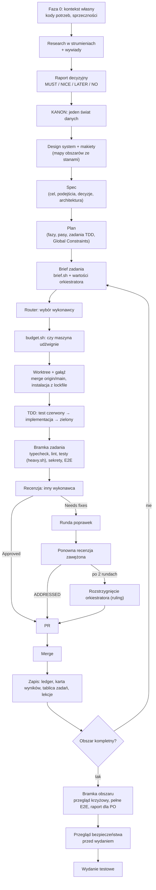

# 02. Proces od pomysłu do wydania

**Cel:** mapa etapów procesu z artefaktami oraz pętla pracy orkiestratora. **Czyta:** orkiestrator, PO. **Kiedy:** na start projektu, przy planowaniu fazy i w każdym ticku pętli orkiestratora.

**Mapa sekcji**
- §Diagram — przebieg od fazy 0 do wydania testowego (mermaid).
- §Reguły — PRC-1…PRC-23: kolejność etapów, artefakty, warunki zlecenia, zapis po merge, pętla sterowana `tick.mjs`, stany zadań przez `task.sh`, nadzór.
- §Procedura / Pętla orkiestratora — kroki jednego ticku z poleceniami.
- §Procedura / Stany zadania — polecenia `task.sh` i wpisy w ledgerze.
- §Etapy i artefakty — tabela: etap → kto → artefakt → szablon → dokument.
- §Checklista — kontrola ticku.

## Diagram



## Reguły

**PRC-1.** Przechodź etapy w kolejności diagramu; etap pomiń tylko, gdy nie obejmuje go poziom wdrożenia (`13-wdrozenie-w-projekcie.md` §Poziom → reguły obowiązkowe — co jest obowiązkowe w minimum, standard, full), albo rulingiem z uzasadnieniem.

**PRC-2.** Discovery (faza 0, research, raport decyzyjny) prowadź dla nowego produktu i decyzji o zakresie MVP; rozwój istniejącego produktu z jasnym backlogiem zaczynaj od specu (`03-discovery-research-makiety.md` §Procedura — kolejność kroków discovery).

**PRC-3.** Każdy etap kończy się artefaktem w ścieżce z §Etapy i artefakty; etap bez artefaktu jest niezamknięty.

**PRC-4.** Przed każdym zleceniem wybierz wykonawcę routerem (`node .workflow/routing/route.mjs <typ>`), a bez routera tabelą ról z `CLAUDE.md`; od poziomu standard zlecaj tylko, gdy `bash .workflow/bin/budget.sh agent|executor|e2e` zwróci `OK` (minimum: tryb sekwencyjny, jeden implementer naraz).

**PRC-5.** Start gałęzi zadania: ORK-33 (`06-orkiestracja-i-role.md` §Worktree i gałęzie — nazewnictwo, baza, sprzątanie).

**PRC-6.** Implementacja idzie w TDD: test czerwony, implementacja, test zielony; każdy krok to commit (`05-jak-kodowac.md` §TDD i E2E — dowód RED/GREEN w raporcie).

**PRC-7.** Recenzję zlecaj dopiero po zielonej bramce zadania: typecheck, lint, testy przez `heavy.sh`, `check-secrets.sh` bez potoku, E2E, jeśli brief ich wymaga (`08-recenzje-i-bramki.md` §Bramka zadania — skład i dowody).

**PRC-8.** Po merge zapisz wynik zadania w tej samej turze: ledger, karta wyników (`route.mjs --record`), tablica zadań, lekcje (jeśli wystąpił incydent).

**PRC-9.** Gdy wszystkie zadania obszaru są scalone, przeprowadź bramkę obszaru (`08-recenzje-i-bramki.md` §Bramka obszaru — przegląd krzyżowy, E2E, raport dla PO); przed wydaniem testowym przeprowadź przegląd bezpieczeństwa (`09-bezpieczenstwo.md` §Bramki wydania — co blokuje wydanie).

**PRC-10.** Orkiestrator pracuje w pętli: każdy tick zaczyna od `node .workflow/bin/tick.mjs` i wykonuje wskazane kroki; odstęp do następnego ticku bierze z linii `NASTĘPNY_TICK` (AKCJA → od razu; przebiegi w tle bez powiadomień → domyślnie 600 s; tylko agenci → zapas domyślnie 1800 s, bo głównym sygnałem jest powiadomienie o końcu agenta; wartości skalibruj rulingiem).

**PRC-11.** Prośba o status agentowi powyżej progu: ORK-25; wysłanie zapisz `task.sh <id> status-request` (PRC-19).

**PRC-12.** Odbierając wynik, sprawdź kod wyjścia **i** liczbę wyników; kod 0 z zerową liczbą testów albo pustym raportem NIE jest sukcesem.

**PRC-13.** Żywy następny krok zadania „w toku”: MEM-41; sprawdzaj go audytem co 3 godziny (domyślnie; zapisz własną wartość rulingiem), potem `tick.mjs --audit-done`.

**PRC-14.** Każdą zmianę kolejności kandydatów po `route.mjs --rebalance` zapisz w ledgerze rulingiem.

**PRC-15.** Prompt wybudzenia pętli jest stały: „uruchom `node .workflow/bin/tick.mjs` i wykonaj wskazane kroki”; **NIE WOLNO** wpisywać do niego stanu zadań ani listy kroków — bo stan z chwili planowania przeterminuje się przed wybudzeniem.

**PRC-16.** `tick.mjs` zwraca KONIEC (kod 4) → zatrzymaj pętlę i daj raport PO; CZEKAJ (kod 3) → zaplanuj wybudzenie zgodnie z `NASTĘPNY_TICK`; AKCJA (kod 0) → wykonaj kroki w kolejności tabeli i uruchom tick ponownie.

**PRC-17.** Po odebraniu wyniku przebiegu w tle uruchom `tick.mjs --ack`, po audycie `tick.mjs --audit-done` — bez tego tick zgłasza ten sam krok ponownie.

**PRC-18.** Stany zadania (zlecenie, blokada, anulowanie, samodzielna weryfikacja, prośba o status, status raportu wykonawcy, runda poprawek, zakończenie) zapisuj wyłącznie `.workflow/bin/task.sh`; **NIE WOLNO** pisać tych wpisów ledgera ręcznie — bo `tick.mjs` czyta tylko gramatykę skryptu (§Stany zadania).

**PRC-19.** Po wysłaniu prośby o status zapisz `task.sh <id> status-request` — tick wycisza wtedy ponowną prośbę na czas progu ORK-25.

**PRC-20.** Po bramce obszaru zapisz `task.sh gate <obszar>`, po wydaniu `task.sh release`; `tick.mjs` zwraca KONIEC dopiero, gdy po ostatnim `complete` jest wpis `Gate` albo `Release`.

**PRC-21.** Tick bez planu zwraca START: napisz spec i plan (albo wskaż plan `tick.mjs --plan <ścieżka>`) i dopiero wtedy zlecaj.

**PRC-22.** W zespole działaj tylko na zadaniach z własnej części tabeli ticku; sekcja „Inni (informacyjnie)” pokazuje zadania innych orkiestratorów — nie zlecaj ich i nie zapisuj ich stanów.

**PRC-23.** Wybudzenie planuj dokładnie promptem „uruchom `node .workflow/bin/tick.mjs` i wykonaj wskazane kroki”; strażnik `.claude/hooks/guard-schedule.mjs` (ScheduleWakeup, CronCreate) blokuje prompt bez `tick.mjs` (PRC-15) i każde wybudzenie, gdy tick zwraca KONIEC (PRC-16); zatrzymanie pętli (`stop`) przechodzi zawsze.

## Procedura

### Pętla orkiestratora

0. Uruchom tick i wykonuj tylko kroki z tabeli (kroki 1–7 opisują, co oznaczają):
   ```bash
   node .workflow/bin/tick.mjs        # tabela: zadanie → stan → następny krok → reguła; NASTĘPNY_TICK; kod 0/3/4
   ```
1. Sprawdź agentów. Agentowi powyżej progu z ORK-25 wyślij prośbę o status w 5 liniach: skończone, teraz, czeka na, pliki spoza zakresu, ETA. Zapisz ją i zweryfikuj odpowiedź:
   ```bash
   bash .workflow/bin/task.sh <id> status-request
   git -C <worktree> log -1 --oneline && git -C <worktree> status --short
   ```
2. Odbierz wyniki: raporty, recenzje, przebiegi testów z `.workflow/tasks/<id>/` i `.workflow/runs/`. Czytaj kod wyjścia i liczbę wyników (PRC-12).
3. Dla każdego zakończonego kroku zleć następny: recenzję, rundę poprawek, ponowną recenzję zawężoną, PR albo merge; stan zapisz `task.sh` (§Stany zadania). Raport `NEEDS_CONTEXT` / `BLOCKED` obsłuż według ORK-24; ustalenie Critical idzie bez wyłącznika (REV-24).
4. Zapisz wynik każdego zamkniętego zadania (PRC-8):
   ```bash
   bash .workflow/bin/task.sh <id> complete "<commity, PR, SHA na main>"
   bash .workflow/bin/ruling.sh "<co>" "<dlaczego>" "<koszt błędu>"
   node .workflow/routing/route.mjs --record <typ> <wykonawca> <rundy> <przepuszczone> <id> "<uwaga>" <trudność 1–3>
   ```
5. Wypełnij wolne miejsca budżetu następnym niezależnym zadaniem:
   ```bash
   bash .workflow/bin/budget.sh agent     # zlecaj tylko przy OK
   ```
6. W interwale z PRC-13 przeprowadź audyt: każde zadanie „w toku” ma żywy następny krok; tablica zadań zgadza się z gitem i ledgerem (`.workflow/templates/audits/audyt-tablicy.md`).
7. Przebuduj kolejność w routerze i zapisz zmiany rulingiem (PRC-14):
   ```bash
   node .workflow/routing/route.mjs --rebalance
   ```

### Stany zadania

Każde polecenie dopisuje do `.workflow/progress.md` jedną linię z autorem (`workflow.author`) i czasem; w zespole `dispatched` wymaga `--pas`.

| Polecenie | Wpis w ledgerze |
|---|---|
| `task.sh <id> dispatched --exec <wykonawca> --base <sha> [--pas <pas>]` | `Task <id>: dispatched (BASE <sha>) — <wykonawca> by <AUTOR> pas <pas> @ RRRR-MM-DD GG:MM` |
| `task.sh <id> blocked "<co odblokuje>"` | `Task <id>: blocked (<co odblokuje>) by … @ …` |
| `task.sh <id> cancelled "<powód>"` | `Task <id>: cancelled (<powód>) …` |
| `task.sh <id> self-verified --round <k>` | `Task <id>: self-verified r<k> …` (tylko poprawki mechaniczne i UI, ZAS-7) |
| `task.sh <id> status-request` | `Task <id>: status-request …` (PRC-19) |
| `task.sh <id> implementer NEEDS_CONTEXT\|BLOCKED\|DONE\|DONE_WITH_CONCERNS "<opis>"` | `Task <id>: implementer <STATUS> (<opis>) …` (ORK-24) |
| `task.sh <id> fix-round --round <k> --addressed <a> --open <o>` | `Task <id>: fix round <k>/2 (<a> addressed, <o> open) …` |
| `task.sh <id> complete "<opis>"` | `Task <id>: complete (<opis>) …` |
| `task.sh gate <obszar>` · `task.sh release` | `Gate <obszar>: done by … @ …` · `Release: done by … @ …` (PRC-20) |

Sygnały z plików zadania czyta tick z treści, nie z czasu modyfikacji: sekcja `## Runda poprawek <k>` w `report.md`, werdykt pogrubiony w ostatniej sekcji „Ocena” / „Werdykt” recenzji (`**Approved**` / `**Needs fixes**`), status raportu. Nazwy plików w `.workflow/tasks/<id>/`: `brief.md`, `report.md`, `review-r<k>-brief.md`, `review-r<k>.md`, `findings-r<k>.md`, `rereview-r<k>-brief.md`, `rereview-r<k>.md`.

Kody wyjścia `task.sh`: 0 zapisano · 2 brak ledgera albo autora · 64 złe argumenty.

## Szablony i narzędzia

### Etapy i artefakty

| Etap | Kto | Artefakt | Szablon | Dokument |
|---|---|---|---|---|
| Kontekst własny | orkiestrator | `research/0-kontekst-wlasny.md` | `.workflow/templates/discovery/0-kontekst-wlasny.md` | `03-discovery-research-makiety.md` §Faza 0 i kody potrzeb |
| Research | agent na strumień | `research/<strumień>.md`, `research/raw/` | `.workflow/templates/discovery/strumien-researchu.md` | `03-discovery-research-makiety.md` §Strumienie |
| Wywiady | człowiek + agent syntezy | synteza wywiadów | `.workflow/templates/discovery/synteza-wywiadow.md` | `03-discovery-research-makiety.md` §Wywiady |
| Raport decyzyjny | agent + orkiestrator | `raport/*.part` → HTML | `.workflow/templates/discovery/raport-decyzyjny.md` | `03-discovery-research-makiety.md` §Raport decyzyjny |
| Świat danych | orkiestrator | `KANON.md` | `.workflow/templates/discovery/KANON.md` | `03-discovery-research-makiety.md` §KANON |
| Design system | designer (człowiek lub agent) | biblioteka DS, CHANGELOG, tokeny w kodzie | `.workflow/templates/design-system/*` | `10-design-system.md` §Procedura |
| Spec | `designer` | `docs/specs/RRRR-MM-DD-<temat>.md` | `.workflow/templates/spec.md` | `04-spec-i-plan.md` §Specyfikacja |
| Plan | orkiestrator | `docs/plans/RRRR-MM-DD-<temat>.md` | `.workflow/templates/plan.md` | `04-spec-i-plan.md` §Plan |
| Skan przed startem | orkiestrator | `.workflow/skan-przed-startem.md` | plik startowy z instalacji | `11-pamiec-projektu.md` §Ledger decyzji |
| Brief | orkiestrator | `.workflow/tasks/<id>/brief.md` | `.workflow/templates/task/brief.md` | `06-orkiestracja-i-role.md` §Brief |
| Implementacja | implementer | commity, `.workflow/tasks/<id>/report.md` | `.workflow/templates/task/raport.md` | `05-jak-kodowac.md` §Zadanie implementacyjne |
| Recenzja | recenzent | `.workflow/tasks/<id>/review-r<k>.md` (brief: `review-r<k>-brief.md`) | `.workflow/templates/task/recenzja-brief.md`, `recenzja.md` | `08-recenzje-i-bramki.md` §Recenzja zadania |
| Plik ustaleń | orkiestrator | `.workflow/tasks/<id>/findings-r<k>.md` | `.workflow/templates/task/ustalenia.md` | `08-recenzje-i-bramki.md` §Plik ustaleń |
| Ponowna recenzja zawężona | recenzent | `.workflow/tasks/<id>/rereview-r<k>.md` (brief: `rereview-r<k>-brief.md`) | `.workflow/templates/task/rereview.md` | `08-recenzje-i-bramki.md` §Ponowna recenzja zawężona |
| Bramka obszaru | orkiestrator | raport dla PO | `.workflow/templates/gate/raport-dla-PO.md` | `08-recenzje-i-bramki.md` §Bramka obszaru |
| Bezpieczeństwo | agent `security` | `docs/security/przeglad-<data>.md` | `.workflow/templates/security/*` | `09-bezpieczenstwo.md` §Procedura |
| Decyzje, stany zadań | orkiestrator | `.workflow/progress.md` | `.workflow/bin/ruling.sh`, `.workflow/bin/task.sh` | `11-pamiec-projektu.md` §Ledger decyzji |
| Lekcje | orkiestrator | `docs/workflow/lekcje.md` | plik startowy z instalacji | `11-pamiec-projektu.md` §Lekcje |

Narzędzia pętli: `.workflow/bin/tick.mjs`, `.workflow/bin/task.sh`, `.workflow/bin/brief.sh`, `.workflow/routing/route.mjs`, `.workflow/bin/budget.sh`, `.workflow/bin/heavy.sh`, `.workflow/bin/ruling.sh` (`15-slownik-skrypty-szablony.md` §Skrypty — polecenia i kody wyjścia); procedura jako skill: `.claude/skills/orkiestracja-agentow/SKILL.md`.

## Checklista

- [ ] Tick zaczął się od `tick.mjs`; wybudzenie zaplanowane według `NASTĘPNY_TICK` stałym promptem, przy KONIEC pętla zatrzymana (PRC-10, PRC-15, PRC-16).
- [ ] Agenci powyżej progu dostali prośbę o status zapisaną `task.sh … status-request`; odpowiedzi zweryfikowane w gicie (PRC-11, PRC-19).
- [ ] Każda zmiana stanu zadania zapisana `task.sh`, nie ręcznie (PRC-18); po bramce obszaru wpis `Gate` (PRC-20).
- [ ] Wyniki odebrane z kodem wyjścia i liczbą wyników (PRC-12).
- [ ] Każdy zakończony krok ma zlecony następny.
- [ ] Ledger, karta wyników i tablica zadań zaktualizowane w tej samej turze (PRC-8).
- [ ] Wolne miejsca budżetu wypełnione (`budget.sh` → `OK`).
- [ ] Audyt „żywy następny krok” wykonany w interwale (PRC-13).
- [ ] Zmiany kolejności routera zapisane rulingiem (PRC-14).
